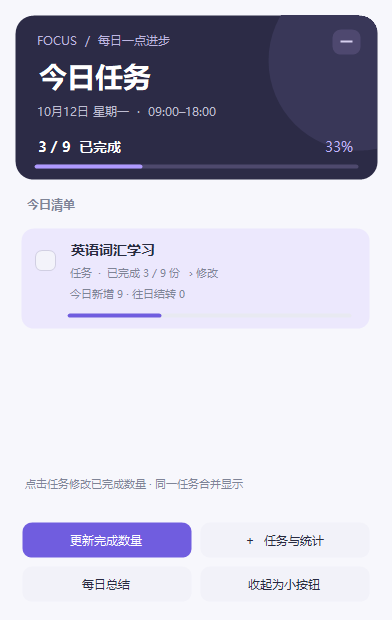
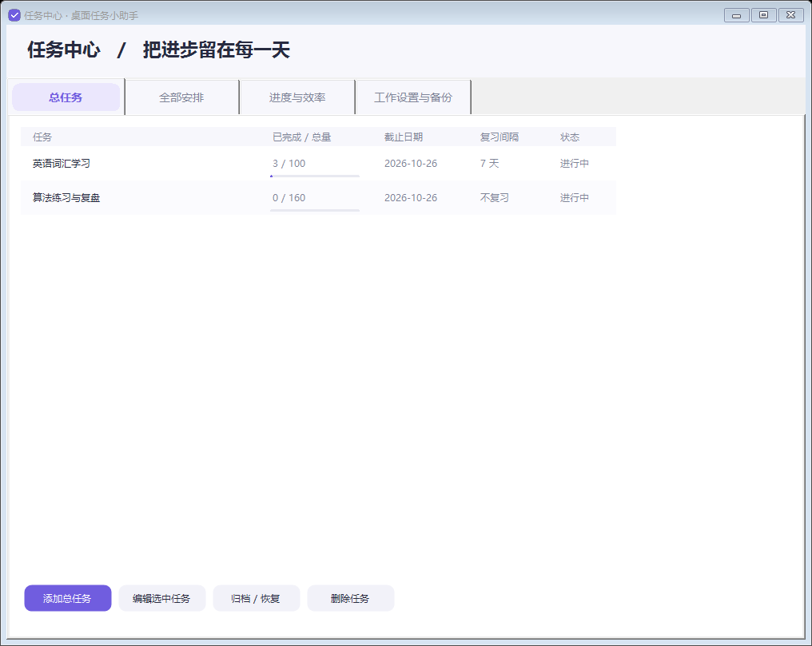
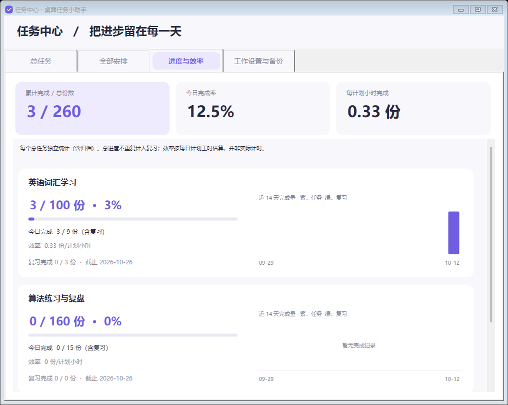
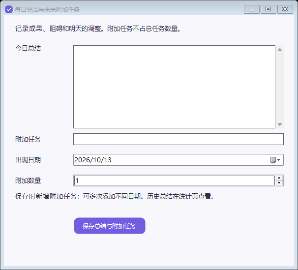

# 桌面任务小助手

一个离线运行的 Windows 桌面学习计划工具，适合考试复习、考研备考、实习学习和课程自学。把“截止日前学完多少内容”拆成每天的任务，在桌面查看、记录完成量，并安排后续复习。

## 界面预览

以下为程序真实界面截图，使用虚构的“英语词汇学习”和“算法练习与复盘”任务生成，不含个人任务或总结数据。

**桌面今日清单**：查看今日计划和完成量，可随时更新数量或收起卡片。



**任务中心**：集中管理学习目标、截止日期和复习间隔。



**进度与效率**：每个目标独立显示完成进度、复习情况和近 14 天图表。



**每日总结**：记录学习进展，并为未来添加附加任务。



## 关键功能

- **自动拆分学习计划**：填写总数量、开始日期和截止日期，按每周各天的权重分配任务。可选择每周学习 5 / 6 / 7 天，或自行设置；权重为 0 表示休息日。
- **桌面今日清单**：同一任务合并显示“已完成 / 今日计划”，支持批量更新数量、加 1、全部完成；可拖动、置顶或收起成小按钮。
- **未完成任务结转**：今天没完成的数量会累加到次日原定任务，保留原计划日期；休息日仍显示积压。
- **完成后安排复习**：设置复习间隔，如 7 天，每份内容实际完成后，在 7 个自然日后安排一次复习；未完成复习持续显示，不会无限生成新复习。
- **每日总结与附加任务**：到设定时间提醒复盘，记录进展、难点，并为明天或未来某天添加额外任务。
- **进度与统计**：分别查看各目标的总进度、今日完成量、复习进度和近 14 天图表；支持归档并保留历史。
- **本地保存与备份**：无需注册、无需联网；支持 JSON 导出与导入，可设置登录 Windows 后自启动。

## 安装与启动

运行环境：Windows，安装有 .NET Framework 4.x；目前不支持 macOS、手机和云同步。

从本仓库下载源码：点击 **Code → Download ZIP** 并解压，在文件夹中打开 PowerShell，运行：

```powershell
powershell.exe -NoProfile -ExecutionPolicy Bypass -File .\Build.ps1
```

编译完成后，双击 `DeskTaskAssistant.exe` 即可试用。要安装并创建快捷方式，双击 `安装小助手.cmd`；安装无需管理员权限，并默认启用登录自启动，可在设置中关闭。

编译使用 Windows 自带的 .NET Framework C# 编译器，无需额外安装 IDE。请在解压后的完整目录中编译，保留图标、源码和脚本。

## 第一次使用

1. 点击桌面卡片上的 **任务与统计 → 工作设置与备份**，设置每天学习时间、总结提醒时间和每周配额，然后保存。
2. 在 **总任务 → 添加总任务** 中填写内容、总数量、起止日期和复习间隔。把一“份”定义成一组单词、一章、一套题或一节课程，便于记录。
3. 回到桌面卡片，点击任务或 **更新完成数量**，填写该任务**今天累计已完成**的份数，例如今天做完 3 份就填 3。也可加 1 或全部完成。
4. 点击 **每日总结** 记录复盘，按需添加未来附加任务。
5. 在 **全部安排** 双击任务查看日期明细；在 **进度与效率** 查看各目标的统计。定期到 **工作设置与备份** 导出备份。

例如：把“10 个学习日完成 100 组考研词汇”设成一个总任务，各学习日权重相同时约每天 10 组；复习间隔设为 7 天，今天完成的部分会在 7 天后进入复习清单。这只是使用示例，程序首次启动为空白计划。

## 使用须知

- 总数量创建后固定；增加学习内容请新建任务。修改日期或每周配额时，仅重排未来未完成的内容，保留今日任务、积压和完成记录。
- 学习起止时间用于展示和效率估算，不限制打卡时间。“效率”按计划小时计算，**不是实际专注计时**。
- 关机、休眠或退出程序期间不会弹提醒；恢复或重新启动后会更新跨天任务。系统通知设置也可能影响提醒。
- 关闭卡片会留下小按钮；右键系统托盘图标选择 **退出** 才会完全退出。
- 保存总结时，填写的附加任务会新增；重复编辑总结时请避免重复提交同一附加任务。

## 数据与隐私

任务、总结和窗口设置仅保存在本机：

```text
%LOCALAPPDATA%\DeskTaskAssistant\data.json
```

每次保存会保留上一版本 `.bak`，导入前会另存原数据。建议定期导出到其他磁盘。

**公开仓库不包含作者的个人任务、总结、JSON 备份或使用数据截图。** 提交代码或反馈问题时，也请勿附带自己的数据文件和含私人内容的截图。

卸载：在 **工作设置与备份 → 卸载小助手**，或 Windows 的已安装应用中卸载；可选择保留或删除本地数据。

## 开发与验证

使用 C#、Windows Forms 和 .NET Framework，无第三方运行依赖。

```powershell
powershell.exe -NoProfile -ExecutionPolicy Bypass -File .\Build.ps1
Start-Process -FilePath .\DeskTaskAssistant.exe -ArgumentList '--self-test' -Wait
Get-Content .\test-results.txt
```

自检覆盖任务分配、复习、数量更新、跨天结转和独立任务统计，不读取个人任务数据。`VerifyUI.ps1` 使用临时示例数据检查界面，生成的 `qa-data` 和截图不纳入版本管理。

开源协议：[MIT](LICENSE)。
